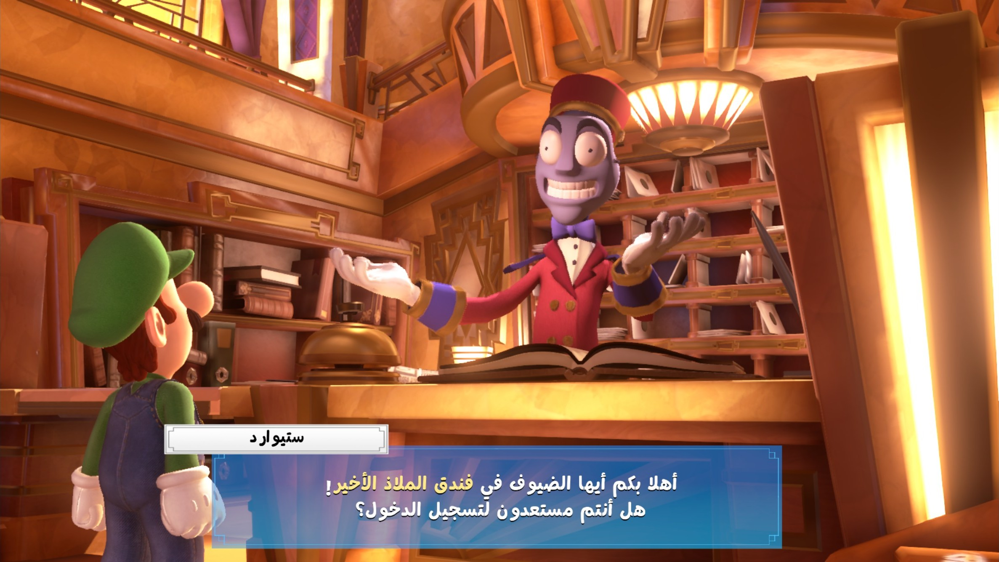
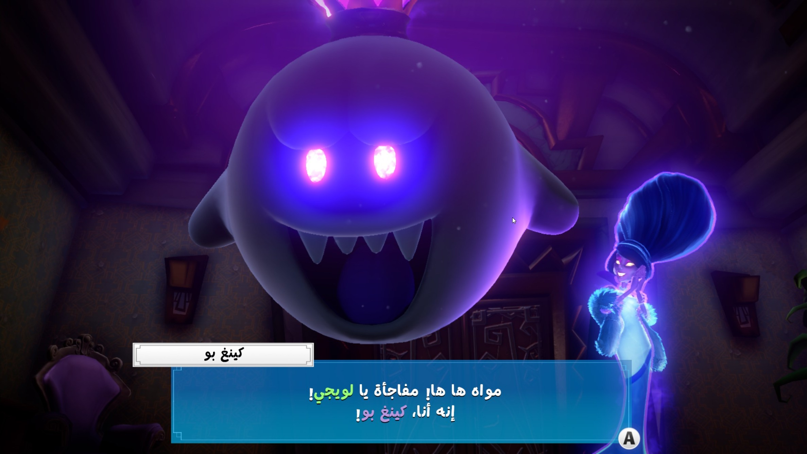
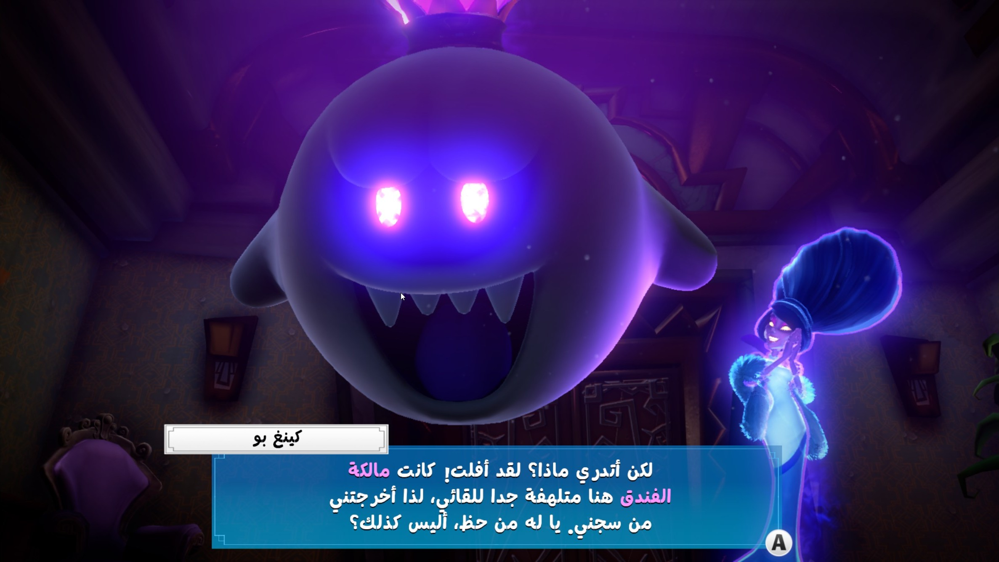

# تعريب Luigi's Mansion 3 | Luigi's Mansion 3 Arabic

تعريب كامل لـ Luigi's Mansion 3 على نينتندو سويتش (الإصدار 1.4.0): حوارات الشخصيات، القوائم والإعدادات، أسماء الطوابق والغرف، التلميحات والرسائل، أطوار اللعب الجماعي، وصفحات المحتوى الإضافي. التعريب يحل محل الإنجليزية.

## اللي تحتاجه

1. اللعبة مع **التحديث 1.4.0**.
2. لغة النظام: **English**.

## التثبيت على Ryujinx أو Eden أو Yuzu

1. حمّل `LuigisMansion3-Arabic.zip` من [Releases](../../releases/latest) وفك ضغطه.
2. في المحاكي: كليك يمين على اللعبة، ثم:
   - **Ryujinx:** اختر Open Mods Directory
   - **Eden / Yuzu:** اختر Open Mod Data Location
3. اسحب مجلد `ArabicTranslation` إلى المجلد اللي انفتح (يشتغل سواء المحاكي محمول portable أو مثبّت عادي).
4. شغّل اللعبة.

## الإزالة

احذف مجلد `ArabicTranslation`. ما يتعدّل أي ملف أصلي من ملفات اللعبة.

| | |
|---|---|
|  |  |

---

## English

Complete Arabic translation of Luigi's Mansion 3 on Nintendo Switch (version 1.4.0): character dialogue, menus and
settings, floor and room names, hints and messages, the multiplayer modes and the DLC pages. The Arabic replaces
English.

### What you need

1. The game with **update 1.4.0**.
2. System language: **English**.

### Install on Ryujinx, Eden or Yuzu

1. Download `LuigisMansion3-Arabic.zip` from [Releases](../../releases/latest) and extract it.
2. In the emulator, right-click the game, then:
   - **Ryujinx:** Open Mods Directory
   - **Eden / Yuzu:** Open Mod Data Location
3. Drag the `ArabicTranslation` folder into the folder that opens (works for portable and normal emulator installs).
4. Start the game.

### Uninstall

Delete the `ArabicTranslation` folder. No original game file is changed.

Font: Playpen Sans Arabic (SIL Open Font License 1.1).

All my translations: https://iosamai.com
